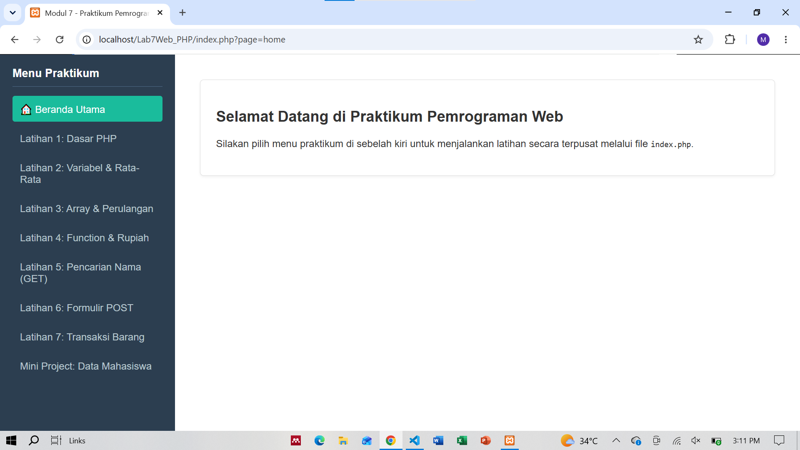
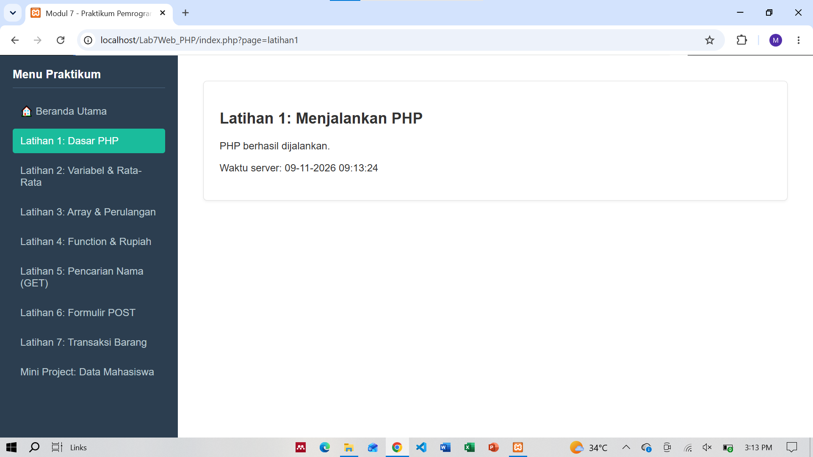
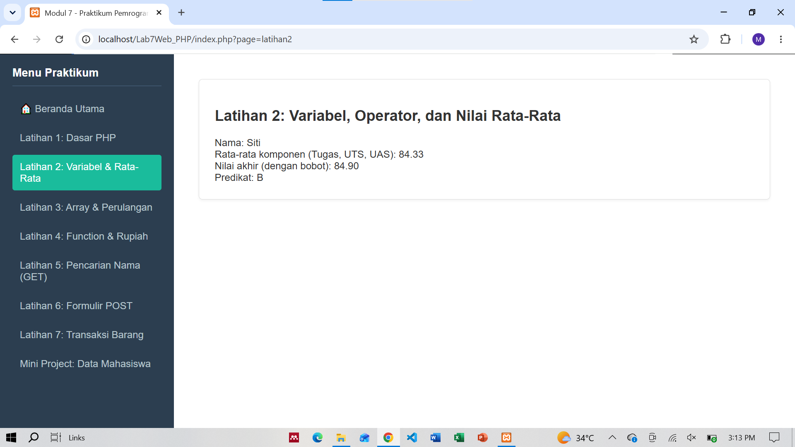
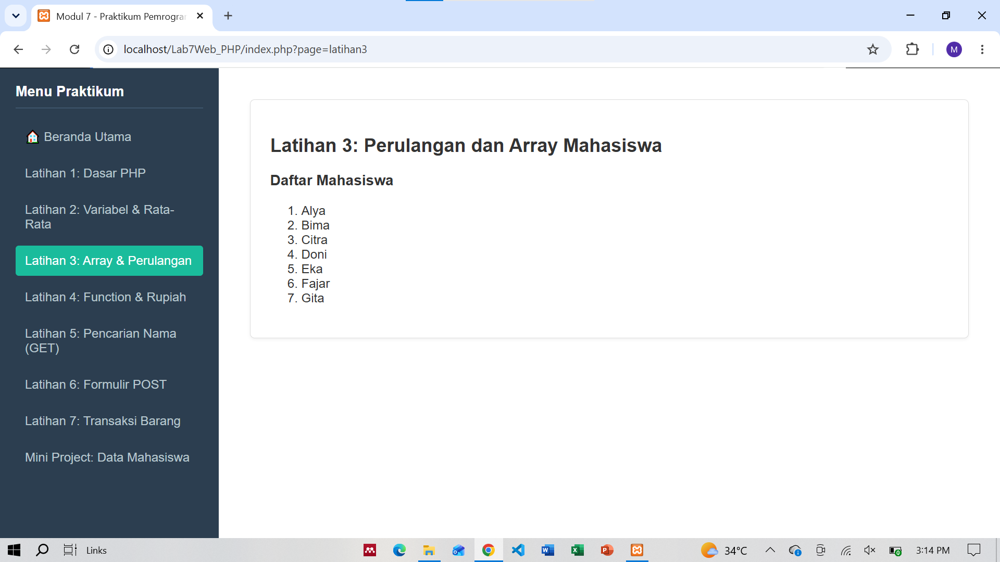
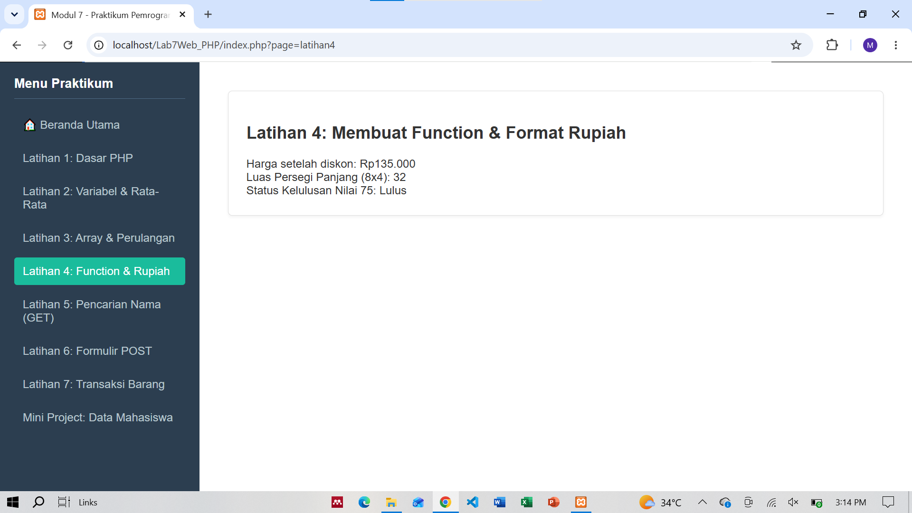
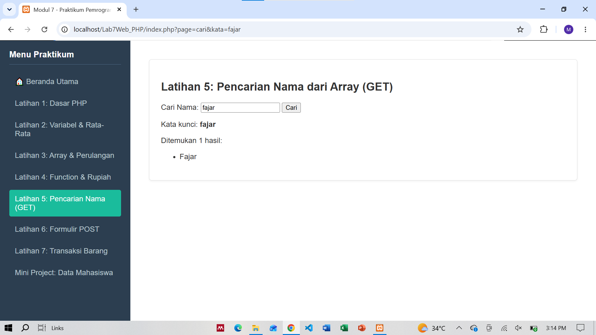
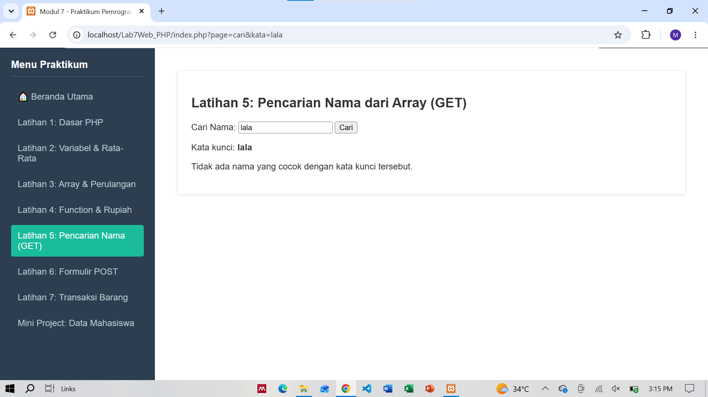
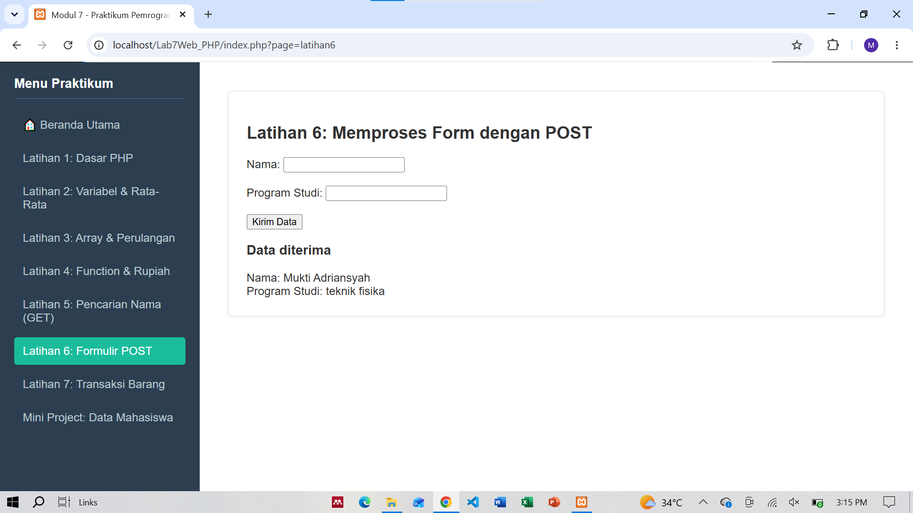
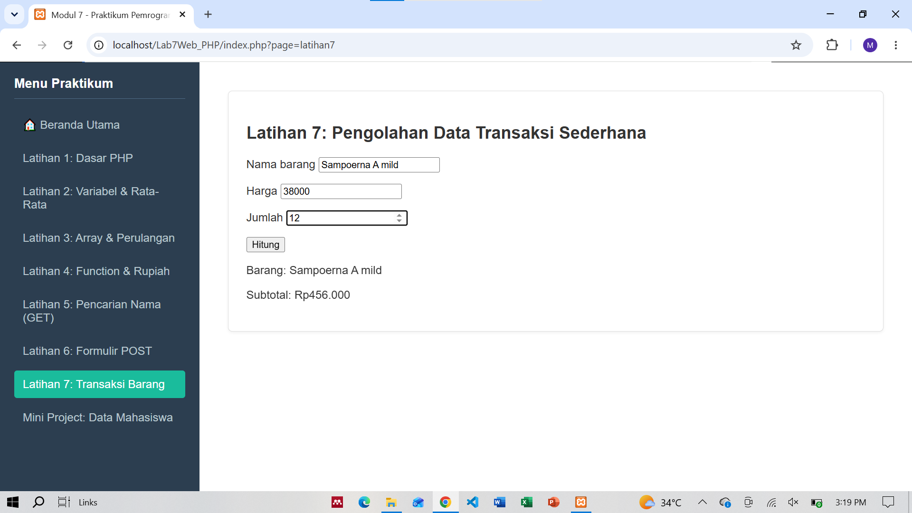
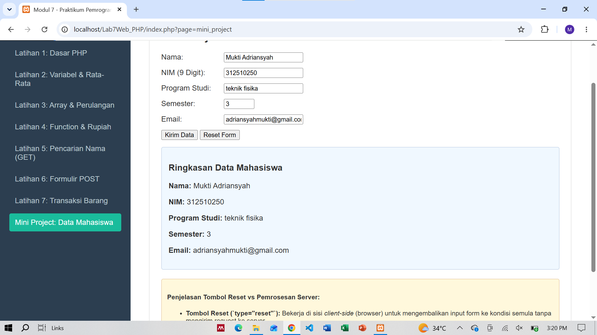

Proyek ini merupakan aplikasi web berbasis PHP yang menggunakan arsitektur **Single Entry Point (Router)** melalui file `index.php`. Seluruh navigasi dan modul latihan dimuat secara terpusat untuk memudahkan pengelolaan struktur kode.

File `index.php` berfungsi sebagai pusat kendali aplikasi (router). Sistem kerjanya meliputi:

* Pengambilan Parameter URL: Menggunakan metode `$_GET['page']` untuk menentukan halaman latihan mana yang sedang aktif. Jika parameter tidak ada, sistem secara otomatis mengarah ke halaman utama (`home`).
* Sidebar Navigasi: Menyediakan menu tautan dinamis yang mendeteksi halaman aktif untuk memberikan efek penanda visual (`class="active"`).
* Dynamic Content Loading: Menggunakan struktur kendali `switch ($page)` untuk memeriksa keberadaan file latihan yang sesuai (`file_exists`) dan menyertakannya ke dalam halaman menggunakan fungsi `include`.

## 2. Rincian Sistem Kerja Modul Latihan

Berikut adalah penjelasan fungsional dari masing-masing komponen latihan:

* Latihan 1: Dasar PHP
* Berfungsi untuk menguji berjalannya mesin PHP pada server lokal.

* Menampilkan informasi dinamis berupa waktu server saat ini menggunakan fungsi bawaan `date("d-m-Y H:i:s")`.

* Latihan 2: Variabel, Operator, & Nilai Rata-Rata**
* Menginisialisasi variabel data mahasiswa dan komponen nilai (Tugas, UTS, UAS).

* Menghitung nilai rata-rata komponen serta nilai akhir berdasarkan bobot persentase tertentu.

* Menggunakan struktur kondisi (`if-elseif-else`) untuk menentukan predikat huruf (A, B, C, atau D) serta fungsi `number_format` untuk memformat desimal angka.

* Latihan 3: Array & Perulangan Mahasiswa
* Menggunakan struktur data array terindeks untuk menyimpan kumpulan nama mahasiswa.

* Menambahkan elemen baru ke dalam array secara dinamis, lalu menampilkannya dalam bentuk daftar bernomor (`<ol>`) menggunakan perulangan `foreach` serta pengamanan `htmlspecialchars`.

* Latihan 4: Pembuatan Fungsi & Format Rupiah
* Mendefinisikan beberapa fungsi modular guna mendukung komputasi matematika dan string:
* `hitungDiskon`: Menghitung nominal harga setelah dipotong persentase diskon.

* `formatRupiah`: Mengubah angka numerik menjadi format mata uang Rupiah (`Rp...`) menggunakan `number_format`.

* `hitungLuasPersegiPanjang`: Menghitung luas bidang datar.

* `cekKelulusan`: Menggunakan operator ternary untuk menentukan status kelulusan berdasarkan ambang batas nilai.

* Latihan 5: Pencarian Nama dari Array (GET)
* Memproses input kata kunci pencarian dari pengguna melalui metode HTTP `GET` (`$_GET["kata"]`).

* Melakukan iterasi pencarian string pada array nama menggunakan fungsi `stripos` agar pencarian bersifat *case-insensitive* (tidak sensitif huruf besar/kecil).

* Menyaring dan menampilkan daftar nama yang cocok atau memberikan informasi jika data tidak ditemukan.

* Latihan 6: Pemrosesan Formulir dengan POST
* Menerima data masukan form (Nama dan Program Studi) menggunakan metode HTTP `POST`.

* Memastikan validasi bahwa request benar-benar dikirim melalui metode `POST` untuk halaman latihan terkait, serta memastikan tidak ada input yang kosong (`trim` dan pengecekan spasi) sebelum data divalidasi dan dicetak ulang secara aman.

* Latihan 7: Pengolahan Data Transaksi Sederhana
* Menangani logika transaksi komersial (Nama barang, Harga, dan Jumlah) menggunakan metode `POST`.

* Melakukan validasi tipe data secara ketat (memastikan harga bernilai numerik positif dan jumlah berupa bilangan bulat minimal 1).

* Menghitung nilai `subtotal` (harga dikali jumlah) dan menampilkannya dengan format mata uang rupiah, atau memunculkan pesan kesalahan (*error*) jika input tidak valid.

* Mini Project: Formulir Data Mahasiswa & Validasi Komprehensif
* Menggabungkan formulir pendaftaran data mahasiswa lengkap (Nama, NIM, Program Studi, Semester, dan Email) dengan validasi sisi server (*server-side validation*) yang mendalam.

* Memvalidasi aturan khusus, seperti:
* NIM wajib berupa angka murni persis 9 digit menggunakan fungsi `ctype_digit` dan `strlen`.

* Email divalidasi menggunakan fungsi filter bawaan `FILTER_VALIDATE_EMAIL`.

* Semester dibatasi pada rentang angka 1 sampai 14.

* Menyediakan tombol Reset berbasis client-side (browser) serta kotak penanganan kesalahan (error-box) dan ringkasan sukses success-box secara dinamis.

DOKUMENTASI:

